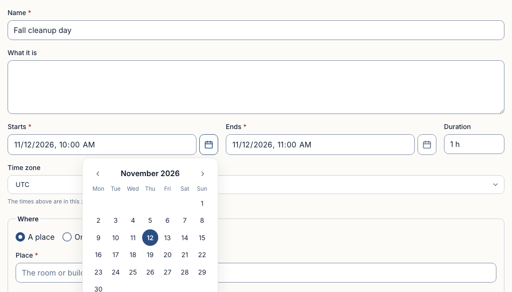
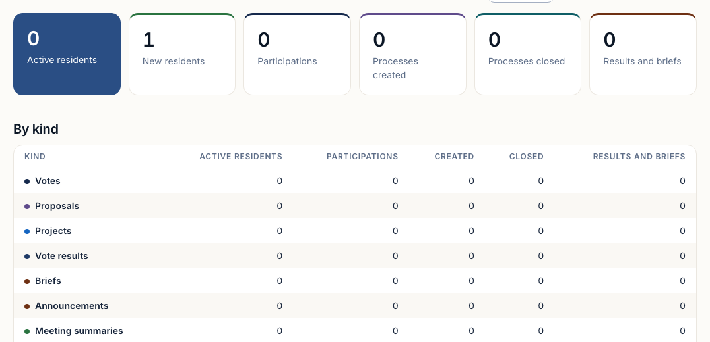

# How a plugin looks: the hub's tokens and kit

A plugin's pages look like the hub they run on, whatever that hub has chosen.
A hub's admin picks its colours, the background's warmth and a font under
Settings → Appearance, and each person picks light or dark for themselves.
Every page follows, plugins included, without the plugin doing anything.

That works only if a plugin sets nothing of its own. The rules:

> **A plugin page is composed of kit components.** Its stylesheet may set
> layout and spacing only: no colour, type, radius, shadow or border of its
> own, not even in tokens. (Conformance step 22.)
>
> **Where it sets layout, it uses the hub's tokens:** `var(--…)`, never
> `#hex`, never `16px`. (Conformance step 21.)

Built that way, a plugin page looks exactly like one of the hub's own pages,
in any hub's theme, light or dark, in Top navigation, Left column or Three
columns. The hub's own Votes, Proposals, Projects, Conversations and Outcomes
pages and the feed are drawn with the same components. An admin can see
every one of them on the hub's `/kit` page.

Conformance step 22 reads each declaration of your `.css` and each key of an
inline style, and refuses `color`, `background`, `font-*`, `line-height`,
`letter-spacing`, `text-transform`, `border*` (and `border-radius`),
`outline`, `box-shadow`, `opacity`, `filter` and custom properties. What is
left is layout: `display`, `flex`/`grid`, `gap`, `margin`, `padding`,
`width`/`height`, `position`, `order`, `overflow`, `align-*`/`justify-*`.

Conformance step 21 checks the values. It reads every `.css` file in your package
and every inline `style={{ … }}` in your `.tsx`. The allowed literals are
`0`, `1px` and `2px`, percentages, `vw`/`vh`, `fr`, `ch`, unitless numbers,
and breakpoints in `@media`. A `var(--x, 12px)` fallback counts as a value of
your own.



## 1. Build the page from the kit

Import the kit from `@civic-social/plugin-sdk/ui`.

### A section page

These are the pieces a section page (Events, Votes, Projects) is made of.
The hub's pages use exactly these.

| Component | What it is | When to use it |
|---|---|---|
| `Page` | The page's container | Around every section page |
| `PageHead` | The title (the page's `h1`), the line under it, and an `action` on the right | Once, at the top. On a phone the action drops under the title |
| `PageAction` | The page's main action: the accent, with a plus | In `PageHead`'s `action`: "Add an event", "Suggest a vote". `href` + `as={Link}` for a route, `onClick` for a dialog |
| `FilterBar` | One pill per choice, one on, sticky under the header | Filtering the page's list by status ("All", "Active", "Completed"). Keep the choice in the URL |
| `ViewToggle` | The same pills, in a row of their own | Two or three ways to see the same things: List / Calendar. Remember the choice per person (`localStorage`) |
| `Group` | A heading (`h2`), a line under it, then its content, inset as every section is | Each part of the page: "Active Votes", "Completed". With `collapsible` the heading folds it away (`defaultOpen` to start open): past events. Without a heading it is the inset alone: put anything that is not already in a section (a `MonthGrid`, a `Notice`, an `EmptyState`) in one, so it keeps the column's edge |
| `DayGroup` | A `Group` whose heading is a day ("Saturday, November 15"), in the zone you give | Date-grouped lists. `groupByDay(items, when, zone)` makes the groups; `dayKey` and `dayHeading` are there too |
| `GroupHeading` | The heading alone | Where a group's heading stands apart from its list |
| `CardList` | Cards one under another at the list's gap | Around `ListCard`s, each in an `<li>` |
| `ListCard` | THE card: a bar in the kind's colour, the kind's chip, the title, a `status`, a meta line; optionally a `summary` and an `image` | Every item of a list. `kind` is your manifest's colour key (`feed.kinds[].color`); `href` + `linkAs={Link}`. `pill="meta"` is the feed's form (title first, the chip leading the meta line, a picture at the side); `pill="top"`, the default, puts the chip row above the title |
| `Chip` | A kind's name on its colour | Saying what kind a thing is, outside a card |
| `StatusChip` | A neutral chip with a dot: `live` (green), `phase` (amber), `done` (grey, never red), `alert` (red) | A thing's state: "Active", "Gathering support", "Completed", "Cancelled". In `ListCard`'s `status` |
| `InlineMeta` | A quiet line of facts | Time, place, count. `ListCard`'s `meta` draws one. Make the fact that matters strong (`<strong>`), the rest plain |
| `EmptyState` | What a list says when it is empty, and an `action` | Instead of an empty list. Say what will appear, and how to make the first |
| `MonthGrid` | A month of days, each with its items as chips; choosing a day calls `onSelect` | A calendar on a wide screen, in a `Group`. Show the chosen day's list under it, in a `DayGroup` |
| `WeekStrip` | A week of days with a dot where something falls | The calendar on a phone, above the chosen day's list |

### A single thing's page

What an event's (or any one thing's) page is made of, under its `PageHead`:

| Component | What it is | When to use it |
|---|---|---|
| `FactList` | Facts, one to a row: a quiet term, its value, and quieter lines under a value | When, Where, Going. `more` holds the quieter lines ("Your time: …") |
| `Notice` | A line on a tinted band: `alert` (red) or `info` (quiet) | What the reader must not miss: "This event was cancelled", "This event has ended" |
| `Note` | A quiet small line | A back link, "Loading…", who a message goes to, when it was sent |
| `Picture` | The thing's own picture, the column's width; `wide` or `preview` | Across the top of its page; smaller in a form |
| `Fieldset` | Fields that belong together, under a name, on a quiet panel | "Where" (a place or a link), "Picture" |

### The hub's clock

Show every time in the hub's zone, and name the zone once on the page ("Times are Eastern Time." in the
`PageHead`'s line, or once in a time's fact). `hubTimeZone()` from `@civic-social/plugin-sdk/ui` gives it, in a
page or a feed card; on the server, `hubContext().timeZone`. Both are the hub's setting, else its place's zone, else
UTC, so never write "UTC" yourself. A new item's default zone is the hub's. Where a reader's own clock differs, a
quieter "Your time: …" may follow.

To choose a zone, use `TimeZoneSelect`: seven zones in plain words, then "More time zones…" for every zone. Put the
hub's own first, as the default, through `first`, e.g. `first={[{ value: hubTimeZone(), label: "Eastern Time, the
hub's own" }]}`. Hub settings → Identity uses the same control.

To offer a few places to go, use `MenuButton`: a pill that opens a short menu of links, e.g. Events' "Add to my
calendar" (Google, Apple, Outlook, another app). Each link takes `newTab` for another site and `download` for a file.
Keep the names short; the pill says what the choice is for.

The calendar views work in calendar days (`"YYYY-MM-DD"`). Work out which
day each item falls on in the zone you mean, with `dayKey(iso, zone)`, and
the grid never meets a time zone. Weeks start on Monday, as the date picker's
do.

### Forms and other surfaces

| You need | Use | Notes |
|---|---|---|
| An action | `Button` | `variant`: `primary` (the page's one main action), `secondary` (the others), `accent` (an invitation to take part: "Going", "Raise something"), `ghost` (a quiet action in a row), `danger` (what cannot be undone); `size="sm"` in rows |
| A labelled field | `Field` around `TextInput`, `TextArea`, `Select` | `required`, `optional`, `hint` |
| A date and time | `DateTimeInput` | ISO in and out; `timeZone` for an event's own zone. It brings the hub's picker |
| Yes or no | `Checkbox` | `label`, `hint` |
| One of a few, explained | `RadioCards` | a title and a line for each choice |
| One of a few, short (a period, a state, an RSVP) | `ChipGroup` | `aria-pressed` on each |
| A picture | `ImageUpload` | gives you the `File`; you upload it |
| Something that holds one thing | `Card` | the hub's edge, radius and padding |
| Numbers | `StatGrid` of `Stat` | the number strong, its label quiet |
| Rows of numbers or records | `Table` | the hub's head, rules, stripes and hover |
| A drafting form's page | `DraftShell` | the slim phone header; takes the page's width. Host-provided: it is the hub's own |

Every page, the kit's and yours, takes the layout's content width. Don't set a
`max-width` on your page.



## 2. Then the tokens, for your own layout

Your stylesheet sets layout and spacing only (step 22); these are the
tokens for those values, and the names the kit's components wear.

The tokens are in `ui/src/styles/theme.css`. Use the role names, which say
what a value is for, never the `--ds-*` palette steps:

- **Surfaces:**
  - `--color-bg` is the page and `--color-surface` a card;
  - `--color-surface-sunken` is a well;
  - `--color-surface-hover` is a row under the pointer;
  - for a card of your own, use `--card-bg`, `--card-border`, `--card-radius`,
    `--card-shadow` and `--card-padding`.
- **Words:**
  - `--color-text`, `--color-text-strong`, `--color-text-muted`, and
    `--color-text-subtle` for the lightest;
  - `--color-link`.
- **On a fill:** always the fill's own pair.
  - `--color-primary-text` on `--color-primary`;
  - `--color-accent-text` on `--color-accent`;
  - `--type-<kind>-fg` on `--type-<kind>-bg`.

  Never dark text on the primary colour: step 17 refuses it.
- **Your type's colour:** the hue you declare in your manifest
  (`feed.kinds[].color`) becomes `--type-<key>-fg` and `--type-<key>-bg`. This
  is the one colour a plugin gives, and the hub's admin can change it. Give
  the key to `ListCard`'s or `Chip`'s `kind` and they wear it; since step 22 a
  package does not set `--card-accent` (or any colour) itself.
- **Status:** `--color-success`, `--color-warning`, `--color-error` and
  `--color-info`, each with a `-bg`.
- **Type:**
  - the roles `--text-display-size` (a page's title), `--text-title-size` (a
    section), `--text-heading-size` (a card's title), `--text-body-size`,
    `--text-small-size`, `--text-caption-size` and `--text-label-size`;
  - weights `--font-weight-regular`, `-medium`, `-semibold` and `-bold`;
  - `--font-body` and `--font-heading`.
- **Space:** a 4px scale numbered by quarter-rem: `--space-1` is 4px,
  `--space-2` 8px, `--space-3` 12px, `--space-4` 16px, `--space-6` 24px and
  `--space-8` 32px.
- **Sizes:**
  - `--control-height` (40px) and `--tap-target` (44px, the least a phone
    finger needs);
  - `--icon-size`;
  - `--radius-sm`, `-md`, `-lg` and `-pill`;
  - `--border-width`.
- **Focus:** `outline: var(--border-width-strong) solid var(--color-focus)`.

Dark mode is the same names with dark values. A plugin that uses only the
tokens is dark-ready with no work.

## 3. Check it

```sh
npx tsx scripts/check-tokens.ts --file packages/<your package>/styles.css
```

This lists every value of your own, line by line; `civic-conformance` runs the
same check as step 21. `tests/unit/contrast.test.ts` in the hub checks that
every pair of tokens meets WCAG AA in light and in dark, so the pairs above
are safe to use.
