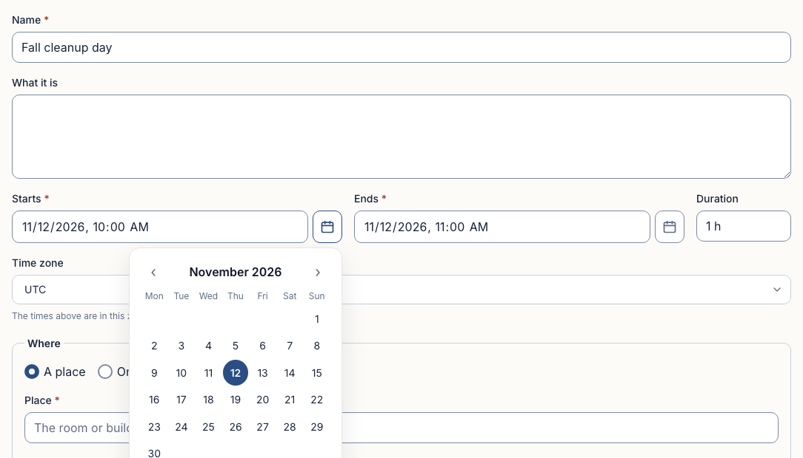
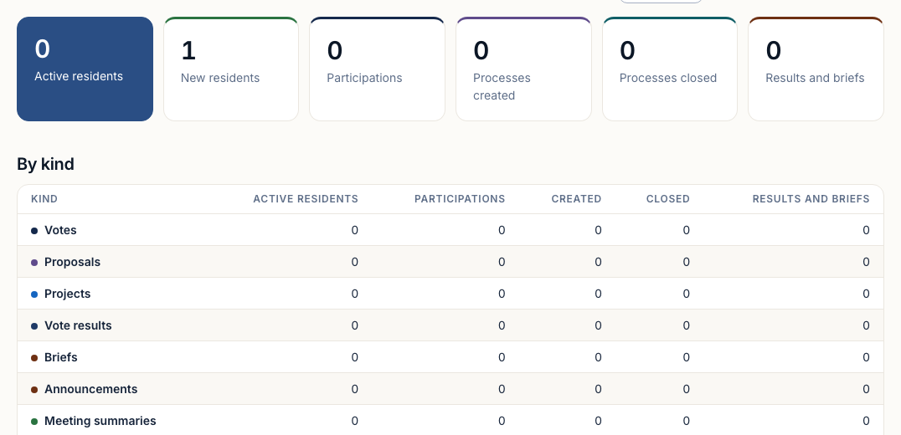

# How a plugin looks: the hub's tokens and kit

A plugin's pages look like the hub they run on, whatever that hub has chosen.
A hub's admin picks its colours, the background's warmth and a font under
Settings → Appearance, and each person picks light or dark for themselves.
Every page follows, plugins included, without the plugin doing anything.

That works only if a plugin sets nothing of its own. The rule:

> **A plugin never sets a colour, a font or a size of its own.** It draws
> with the kit's components, and where it needs its own layout it uses the
> hub's tokens: `var(--…)`, never `#hex`, never `16px`.

Conformance step 21 checks this. It reads every `.css` file in your package
and every inline `style={{ … }}` in your `.tsx`. The allowed literals are
`0`, `1px` and `2px`, percentages, `vw`/`vh`, `fr`, `ch`, unitless numbers,
and breakpoints in `@media`. A `var(--x, 12px)` fallback counts as a value of
your own.



## 1. Use the kit first

Import the kit from `@civic-social/plugin-sdk/ui`.

| You need | Use | Notes |
|---|---|---|
| A page's title and the line under it | `PageHead` | `title`, `lede` |
| An action | `Button` | `variant`: `primary` (the page's one main action), `secondary` (the others), `accent` (an invitation to take part: "Going", "Raise something"), `ghost` (a quiet action in a row), `danger` (what cannot be undone); `size="sm"` in rows |
| A labelled field | `Field` around `TextInput`, `TextArea`, `Select` | `required`, `optional`, `hint` |
| A date and time | `DateTimeInput` | ISO in and out; `timeZone` for an event's own zone. It brings the hub's picker |
| Yes or no | `Checkbox` | `label`, `hint` |
| One of a few, explained | `RadioCards` | a title and a line for each choice |
| One of a few, short (a period, a state, an RSVP) | `ChipGroup` | `aria-pressed` on each |
| A picture | `ImageUpload` | gives you the `File`; you upload it |
| Something that holds one thing | `Card` | the hub's edge, radius and padding |
| Numbers | `StatGrid` of `Stat` | the number strong, its label quiet |
| Rows of numbers or records | `Table` | the hub's head, rules, stripes and hover |
| A drafting form's page | `DraftShell` | the slim phone header; takes the page's width |

Every page, the kit's and yours, takes the layout's content width. Don't set a
`max-width` on your page.



## 2. Then the tokens, for your own layout

The tokens are in `ui/src/styles/theme.css`. Use the role names, which say
what a value is for, never the `--ds-*` palette steps:

- **Surfaces:**
  - `--color-bg` is the page and `--color-surface` a card;
  - `--color-surface-sunken` is a well;
  - `--color-surface-hover` is a row under the pointer;
  - for a card of your own, use `--card-bg`, `--card-border`, `--card-radius`,
    `--card-shadow` and `--card-padding`.
- **Words:**
  - `--color-text`, `--color-text-strong`, `--color-text-muted`, and
    `--color-text-subtle` for the lightest;
  - `--color-link`.
- **On a fill:** always the fill's own pair.
  - `--color-primary-text` on `--color-primary`;
  - `--color-accent-text` on `--color-accent`;
  - `--type-<kind>-fg` on `--type-<kind>-bg`.

  Never dark text on the primary colour: step 17 refuses it.
- **Your type's colour:** the hue you declare in your manifest
  (`feed.kinds[].color`) becomes `--type-<key>-fg` and `--type-<key>-bg`. This
  is the one colour a plugin gives, and the hub's admin can change it. For a
  card's colour bar, use the kit's `kit-card--accent` class with
  `--card-accent: var(--type-<key>-fg)`.
- **Status:** `--color-success`, `--color-warning`, `--color-error` and
  `--color-info`, each with a `-bg`.
- **Type:**
  - the roles `--text-display-size` (a page's title), `--text-title-size` (a
    section), `--text-heading-size` (a card's title), `--text-body-size`,
    `--text-small-size`, `--text-caption-size` and `--text-label-size`;
  - weights `--font-weight-regular`, `-medium`, `-semibold` and `-bold`;
  - `--font-body` and `--font-heading`.
- **Space:** a 4px scale numbered by quarter-rem: `--space-1` is 4px,
  `--space-2` 8px, `--space-3` 12px, `--space-4` 16px, `--space-6` 24px and
  `--space-8` 32px.
- **Sizes:**
  - `--control-height` (40px) and `--tap-target` (44px, the least a phone
    finger needs);
  - `--icon-size`;
  - `--radius-sm`, `-md`, `-lg` and `-pill`;
  - `--border-width`.
- **Focus:** `outline: var(--border-width-strong) solid var(--color-focus)`.

Dark mode is the same names with dark values. A plugin that uses only the
tokens is dark-ready with no work.

## 3. Check it

```sh
npx tsx scripts/check-tokens.ts --file packages/<your package>/styles.css
```

This lists every value of your own, line by line; `civic-conformance` runs the
same check as step 21. `tests/unit/contrast.test.ts` in the hub checks that
every pair of tokens meets WCAG AA in light and in dark, so the pairs above
are safe to use.
